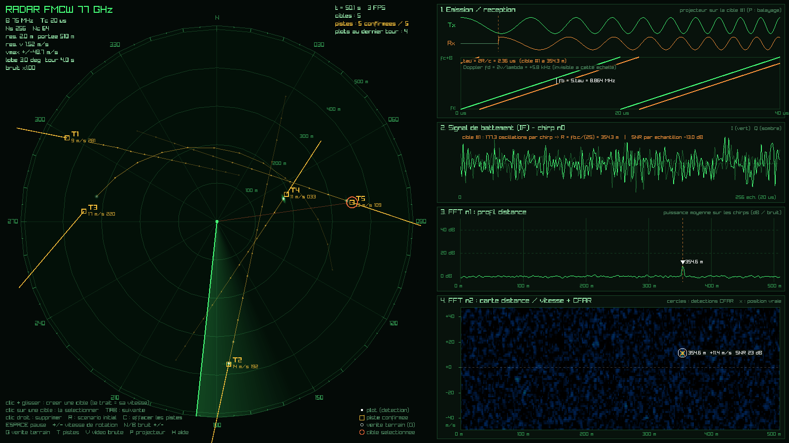

# radar-sim : simulateur de radar FMCW

Simulateur de radar en C++17 + raylib. Tu places des cibles, le programme génère
les échos, puis refait toute la chaîne d'un vrai radar :
**signal → FFT distance → FFT vitesse → CFAR → extraction de plots → pistage Kalman → écran PPI.**



## Compiler et lancer

```bash
make          # télécharge et compile raylib 5.5 au premier lancement (pas besoin de sudo)
make run      # compile puis lance
make test     # tests du traitement du signal et du Kalman (sans écran)
make re       # recompile tout
```

**Prérequis** : `cmake` ≥ 3.16, `g++` ou `clang++` (C++17), `git`, et les en-têtes X11/OpenGL.
Sur Ubuntu/Debian (déjà présents sur la plupart des machines de dev) :

```bash
sudo apt install build-essential cmake git libx11-dev libxrandr-dev libxinerama-dev \
                 libxcursor-dev libxi-dev libgl1-mesa-dev
```

Si raylib est déjà installé sur ta machine : `make CMAKE_FLAGS=-DUSE_SYSTEM_RAYLIB=ON`.

## Commandes

| Action | Effet |
|---|---|
| **clic + glisser** sur le PPI | crée une cible ; le trait tiré donne sa vitesse (≈ distance parcourue en 5 s, 70 m/s max) |
| **clic** sur une cible | la sélectionne (les panneaux de droite l'analysent) |
| **TAB** | cible suivante |
| **clic droit** | supprime la cible la plus proche |
| **ESPACE** | pause |
| **+ / -** | accélère / ralentit la rotation de l'antenne |
| **N / B** | plus / moins de bruit |
| **G** | vérité terrain (vraies positions des cibles) |
| **T** | pistes Kalman |
| **V** | vidéo brute (énergie reçue le long du lobe) |
| **P** | panneaux : « projecteur » sur la cible sélectionnée ↔ dernier écho du balayage |
| **C** | efface les pistes · **R** scénario initial · **H** aide · **Échap** quitter |

Options pratiques : `./build/radar_sim --warmup 30` démarre avec 30 s de simulation déjà
écoulées (pistes déjà confirmées).

## Ce que montre l'écran

**À gauche, le PPI** (Plan Position Indicator) : radar au centre, nord en haut, anneaux tous les 100 m.
La ligne verte tourne comme l'antenne. On y voit :
- la **vidéo brute** (petits points verts) : les cases où l'énergie dépasse le bruit, qui s'estompent en un tour ;
- les **plots** (points blancs) : les détections validées ;
- les **pistes** (carrés jaunes) : la sortie du Kalman, avec l'historique, le vecteur vitesse (position dans 15 s),
  la vitesse et le cap.

**À droite, l'analyse d'un dwell** (Nc chirps tirés dans une direction) :
1. **Émission / réception** : en haut, l'onde émise et l'écho retardé de τ = 2R/c (fréquence ralentie pour être visible) ;
   en bas, la fréquence instantanée des chirps (dents de scie). L'écart vertical entre Tx et Rx est la fréquence de battement.
2. **Signal de battement (IF)** d'un chirp : souvent noyé dans le bruit (SNR par échantillon négatif), et pourtant…
3. **FFT n°1, profil distance** : …la FFT concentre toute l'énergie dans une seule case et la cible sort du bruit.
4. **FFT n°2, carte distance / vitesse** : la seconde FFT, à travers les chirps, sépare les cibles par vitesse radiale.
   Les cercles sont les détections CFAR, les croix les positions vraies.

## La physique en bref

Un chirp balaie de fc à fc + B pendant Tc (pente S = B / Tc). L'écho d'une cible à la distance R revient
avec un retard τ = 2R/c. En multipliant émission et réception, on obtient le **signal de battement** :

| Grandeur | Formule | Valeur par défaut |
|---|---|---|
| fréquence de battement | fb = S·τ = 2·S·R / c | 2,5 MHz pour 100 m |
| résolution en distance | c / 2B | 2,0 m |
| portée max (IF complexe) | (Ns − 1) · c / 2B | 510 m |
| décalage Doppler | fd = 2v / λ | 513 Hz par m/s |
| résolution en vitesse | λ / (2·Nc·Tc) | 1,52 m/s |
| vitesse max non ambiguë | ± λ / (4·Tc) | ± 48,7 m/s |

Paramètres : fc = 77 GHz, B = 75 MHz, Tc = 20 µs, Ns = 256 échantillons/chirp, Nc = 64 chirps/dwell,
lobe de 3°, un tour en 4 s. Tout est dans `src/core/params.hpp`.

L'amplitude de l'écho suit l'équation radar : puissance en 1/R⁴, donc amplitude en √RCS / R².
Une cible de 1 m² à 500 m sort à ~10 dB au-dessus du bruit après les deux FFT.

## La chaîne de traitement

| Étape | Fichier | Idée |
|---|---|---|
| Simulation | `src/core/simulator.cpp` | pour chaque cible dans le lobe : phase 2π(fb+fd)·n/fs + 2π·fd·m·Tc + 4πR/λ, plus un bruit gaussien I/Q |
| FFT | `src/core/fft.cpp` | Cooley-Tukey radix-2 itérative maison (bit-reversal puis papillons), fenêtre de Hann |
| Distance / vitesse | `src/core/range_doppler.cpp` | FFT sur chaque chirp (distance), puis FFT sur chaque case à travers les chirps (vitesse), puis fftshift |
| Détection | `src/core/cfar.cpp` | **CA-CFAR 2D** : seuil = α · moyenne des cases d'entraînement (hors cases de garde), α = N(Pfa^(−1/N) − 1) ; sommes rapides par image intégrale ; maxima locaux ; suppression des lobes secondaires |
| Plots | `src/core/cfar.cpp` (`PlotExtractor`) | regroupe les détections d'une cible vue sur plusieurs dwells ; azimut = barycentre pondéré par le SNR ; règle « 2 dwells minimum » contre les fausses alarmes isolées |
| Pistage | `src/core/tracker.cpp` | **Kalman vitesse constante** [x, y, vx, vy] ; bruit de mesure converti du polaire (distance, azimut) au cartésien ; association au plus proche voisin (distance de Mahalanobis, porte χ² 99,9 %) ; piste confirmée après 3 plots, supprimée après 2,5 tours sans plot |
| Affichage | `src/app/` | raylib : `ppi.cpp` (écran radar), `plots.cpp` (panneaux), `main.cpp` (boucle, entrées) |

Le cœur (`src/core/`) ne dépend pas de raylib : `make test` le vérifie sans écran
(FFT contre DFT naïve, distance et vitesse retrouvées, taux de fausses alarmes, convergence du Kalman,
scénario complet à 5 cibles).

## Choses à observer

- **Le gain de la FFT** : sélectionne une cible lointaine (TAB). Le signal IF (panneau 2) n'est que du bruit,
  mais la cible sort nettement du profil distance (panneau 3).
- **Le Doppler** : une cible qui s'approche a une vitesse négative sur la carte (panneau 4), une cible qui passe
  perpendiculairement au radar a une vitesse radiale nulle.
- **L'ambiguïté Doppler** : crée une cible rapide (long trait) qui fonce vers le radar à plus de 48,7 m/s.
  Sa vitesse se « replie » de l'autre côté de la carte distance / vitesse.
- **Le bruit** (N) : le SNR baisse, les cibles lointaines et petites ne sont plus détectées à chaque tour,
  et leurs pistes finissent par être perdues.
- **Le Kalman** : active la vérité terrain (G) et compare les pistes aux vraies positions. Les virages
  (demi-tours en bord de zone) montrent le retard du filtre.

## Pour aller plus loin

- mesurer l'azimut plus finement (monopulse) au lieu du barycentre des dwells ;
- ajouter du fouillis (sol, pluie) et un filtre MTI ou un seuil CFAR « OS » (ordered statistics) ;
- utiliser la vitesse radiale mesurée dans le Kalman (filtre de Kalman étendu) ;
- association globale (algorithme hongrois, JPDA) pour les cibles qui se croisent ;
- une vraie source : clé RTL-SDR, module radar mmWave (TI IWR, Infineon BGT60…).

## Références

- [radartutorial.eu](https://www.radartutorial.eu) : FMCW, Doppler, PPI, CFAR
- Wikipédia : *Transformée de Fourier rapide*, *Constant false alarm rate*, *Filtre de Kalman*
- [raylib.com/examples](https://www.raylib.com/examples.html)
